# AnchorPoint

> **A WireGuard link between two of your locations, where each site is both a local
> gateway and an internet exit for the other.** Plug into a port (or join a Wi-Fi
> SSID) at site A and browse as if you were at site B. Config-driven: you edit one
> small YAML file and the tool generates the complete, reproducible RouterOS config
> for both sides — secrets encrypted, never committed.

Built for MikroTik RouterOS v7 (hAP ax2 and similar). Validated on RouterOS CHR
7.20.8 (handshake, both-way exit, leak-proof fail-closed).

Each site has a short **identifier** (a city, a code — any short label), used for its
interface names, routing table, device identity and secret keys.



---

## How it works

```
your small config          generate secrets                 render
inventory/example.yaml ─►  secrets/<name>.sops.yaml    ─►  deployments/<site>/bootstrap.sensitive.rsc
(the two sites, port,       (per-site WG keypair + admin       (the RouterOS config for BOTH sides;
 SSIDs, endpoints)           + wifi pw — random, ENCRYPTED)     all addressing derived)
        gen-mesh-secrets.py   (writes public keys back)   render-mesh.py
```

- **You hand-write** only the small inventory: each site's `id`/name, its public
  endpoint (`ddns`), a Wi-Fi `ssid_suffix`; and for the link, the `wg_port` and `wifi_ssid_prefix`.
- **Generated for you** (never typed, never committed): the two WireGuard keypairs, the
  admin password and the Wi-Fi passphrase — random, stored only in the SOPS-encrypted bundle.
- Public keys are derived and written back into the inventory (non-secret).

## Port map per site (hAP ax2, 5 ports)

| Port | Role |
|------|------|
| `ether1` | WAN / uplink (your local ISP) |
| `ether2` | **Exit** via the other site |
| `ether3` / `ether4` / `ether5` | **Local** network (normal local internet) |
| Wi-Fi | own SSID = local · the other site's SSID = exit via that site |

So the port you plug into — or the SSID you join — decides which country you browse from.

## Addressing (two sites: A = index 1, B = index 2 — all derived)

| Thing | Site A | Site B |
|-------|--------|--------|
| Overlay id (tunnel source + watchdog target) | `10.0.80.1/32` | `10.0.80.2/32` |
| Local LAN (SSID `<prefix>-<suffix>`) | `192.168.10.0/24` | `192.168.20.0/24` |
| Exit subnet (traffic out via the other site) | `192.168.11.0/24` | `192.168.21.0/24` |
| Tunnel | `UDP <wg_port>` — both ends | ← same |

**Leak-proof:** the exit subnet is policy-routed into the tunnel with
`action=lookup-only-in-table` — if the tunnel drops, exit traffic is **dropped, not
leaked** to the local ISP. FastTrack is disabled (it bypasses policy routing + MSS clamp).

---

## Prerequisites

```bash
brew install sops age d2                 # macOS (or your package manager)
python3 -m venv .venv && . .venv/bin/activate
pip install jinja2 pyyaml cryptography ruamel.yaml

# One age keypair per operator. Keep the PRIVATE key safe and OUT of the repo.
age-keygen -o ~/.age/keys.txt            # prints "Public key: age1..."
export SOPS_AGE_KEY_FILE=$HOME/.age/keys.txt    # to decrypt / render
export AGE_RECIPIENT=age1...                     # your PUBLIC key, to encrypt
```

## Quickstart

```bash
# 1. Describe your two sites (copy the example; set each site's ddns + ssid_suffix, and wg_port)
cp inventory/example.yaml inventory/my-link.yaml

# 2. Generate keys + passwords (encrypted bundle; public keys written back)
scripts/gen-mesh-secrets.py --inventory inventory/my-link.yaml

# 3. Render the config for both sides
scripts/render-mesh.py --inventory inventory/my-link.yaml --out deployments

# 4. (optional) diagram
scripts/render-diagrams.sh deployments/architecture.d2
```

Each site gets `deployments/<site>/bootstrap.sensitive.rsc` (encrypted),
`bootstrap.rsc` (redacted, safe to read), and `cheatsheet.md` (a printable install card).
Decrypt a site's config to a scratch file **outside the repo**, paste it into that
router over a console/WinBox terminal, then shred the scratch file.

Full runbook — DDNS/CGNAT collection, port-forwarding, flashing, verification,
day-2 ops — in **[docs/ONBOARDING.md](docs/ONBOARDING.md)**.

## Config knobs (inventory)

| Field | Where | Meaning |
|-------|-------|---------|
| `id`, `color`, `location`, `country` | per site | identity / labels (`color` = the site's short identifier) |
| `ddns` | per site | the site's public endpoint (DDNS name or public IP) |
| `ssid_suffix` | per site | Wi-Fi SSID = `wifi_ssid_prefix` + `-` + suffix |
| `wifi_ssid_prefix` | link | base SSID name |
| `wg_port` | link | the WireGuard UDP port (both ends) |

(A site may instead carry a full `ssid` for back-compat; `ssid_suffix` wins when present.)

> The `mesh:` block and the `mesh-*` script/template names are just the internal
> tooling names — this builds a **two-site link**.

## What's in git (and what's never)

| Kind | In git? |
|------|---------|
| Scripts, templates, example inventory, example secrets file | ✅ |
| Your real secrets bundle `secrets/*.sops.yaml` | ❌ gitignored |
| Generated `deployments/` (rendered configs, even encrypted) | ❌ gitignored |
| age private key `~/.age/keys.txt`, `.venv/` | ❌ gitignored / outside repo |

Secrets are unique per operator — you generate your own; nothing sensitive is shared via this repo.

## Validation

Validated on RouterOS CHR 7.20.8: WireGuard handshake both ways, per-tunnel `netwatch`
watchdog up, both-way internet exit (traffic egresses at the other site's WAN),
local-LAN via own WAN, and fail-closed (tunnel down → exit dropped, no leak). Re-test
Wi-Fi VAPs + physical bridge-port moves on your exact hardware/build before production.
